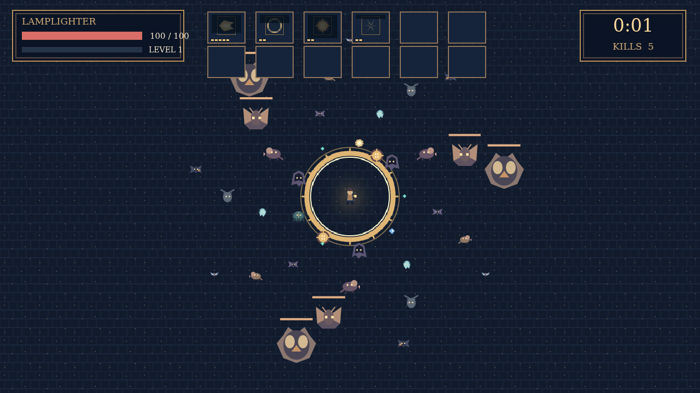

# Wick

A lamplighter walks alone through a city that has forgotten the sun. The first moths follow the flame. Soon bats, shades, and heavier things gather at its edge. The lamplighter only walks; every tool fires on its own rhythm, so the route through the crowd is yours to choose.

Fallen enemies leave gems. Gather them to level up and choose from three tools and trinkets, each changing how the light fights. An elite's chest can turn a fully grown tool into something fiercer when its matching trinket is in your kit.

At nine minutes the Dark arrives. Keep the lamp burning, outrun what you cannot kill, and make it to dawn at ten.
